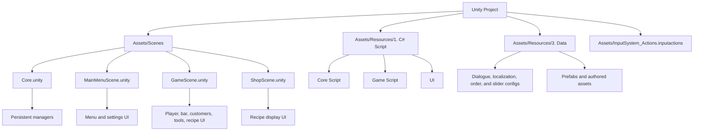

# Viles W/ Smiles

`Viles W/ Smiles` is a Unity 2D bartending game project. The player serves customer orders by following recipe steps, progresses through shifts, earns money toward a fixed debt, and advances through tutorial and dialogue sequences.

<table>
  <tr>
  <td style="width: 33.33%; height: 250px;">
    
  </td>
  
  <td style="width: 33.33%; height: 250px;">
    
  </td>
  
  <td style="width: 33.33%; height: 250px;">
    
  </td>
  </tr>
</table>

## Contributors

| Contributor | Role | Contribution |
|---|---|---|
| **Natanael Kevin Kurniawan** | **Game Programmer & Game Designer** | Designed and implemented the game's core gameplay loop and primary mechanics, translating the game's concept into its playable systems and interactions. |
| **Erika Gabriela** | **2D Artist** | Created the game's environments and character artwork using a distinctive line-art visual style, establishing the project's overall visual identity. |
| **Dave Franklin** | **UI Artist** | Designed the UI workflow and wireframes, establishing the interface structure and user flow. Also created the supporting UI iconography and visual assets. |

## Time Spent: 2 Days / ~44 Hours

## Features

- Customer-driven drink orders with randomized and predefined shift data.
- Six built-in recipes: The Old Coin, Clear Lie, Dark Favour, The Manager's, Spiced Heritage, and Morning Reviver.
- Step-based drink preparation using ingredients and bar tools such as the shaker, spoon, cutting board, juicer, glass, and trash bin.
- Mistake tracking, drink completion, delivery, and customer reactions.
- Intro/tutorial flow, shift dialogue, and an end-of-game sequence.
- Localization data for English, Italian, and Indonesian.
- Persistent JSON save data for settings, tutorial state, shift progress, money, and completion state.
- Main menu, gameplay, and recipe-book/shop UI managed through additive scenes.

## Project Structure

The main authored areas are:

- `Assets/Scenes`: the four scenes included in the build, with `Core` listed first.
- `Assets/Resources/1. C# Script/Core Script`: scene loading, game state, flow, saving, audio, localization, and camera/light management.
- `Assets/Resources/1. C# Script/Game Script`: player interaction, customers, shifts, recipes, drink preparation, and dialogue.
- `Assets/Resources/1. C# Script/UI`: menu, recipe-book, status, and reusable UI behavior.
- `Assets/Resources/3. Data`: serialized configuration, audio, fonts, prefabs, dialogue, localization, and order data.

The repository also contains bundled or supporting packages and tools, including Nova UI, NaughtyAttributes, Sortify, TimeScale Toolbar, TextMesh Pro, and related editor assets.

## Important Systems / Architecture

- `GameStateManager` exposes `MainMenu`, `Playing`, and `Shop` states. `AdditiveSceneManager` loads the menu, gameplay, and shop scenes additively; the state manager activates the appropriate tagged root.
- `GameFlowManager` connects state changes to the intro/tutorial and final sequence. Tutorial completion starts the first shift.
- `CustomerManager` and the order-system scripts create or load customers, begin shifts, and start orders when a customer is selected.
- `RecipeBook` defines the recipe steps. `DrinkMaker` validates the current ingredient/tool action, tracks progress and mistakes, and reports completion or delivery results.
- Persistent managers use singleton-style instances and `DontDestroyOnLoad`, allowing state, saving, audio, input, dialogue, localization, and customer flow to span additive scenes.
- `SaveManager` reads and writes `save.json` under Unity's `Application.persistentDataPath`.

## Development Notes

- Open the project with Unity `6000.2.6f2`.
- The build scene order is `Core`, `MainMenuScene`, `GameScene`, then `ShopScene`. Start from `Assets/Scenes/Core.unity` so the persistent managers initialize correctly.
- Input is configured in `Assets/InputSystem_Actions.inputactions`. Player movement supports keyboard A/D and arrow keys; interaction is bound to F, with UI navigation and pause/inventory actions also defined in the asset.
- The project uses the Input System, Universal Render Pipeline, Cinemachine, UGUI, Timeline, and Unity 2D packages declared in `Packages/manifest.json`.
- The configured default player resolution is 1920x1080.
